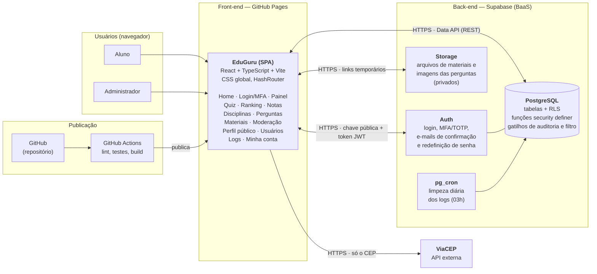

# Diagrama de Arquitetura (Figura 1) — versão de 05/11

Substitui a Figura 1 da monografia (seção 1.3). A figura antiga tinha Tailwind e "JWT / Go" e
não tinha Storage, pg_cron, ViaCEP nem GitHub.

**Como exportar em alta resolução:**
1. Abra https://mermaid.live
2. Apague o exemplo e cole o bloco de código abaixo (só o que está entre as linhas com três crases).
3. Menu **Actions → PNG** com escala 3x ou 4x (ou **SVG**, que nunca perde qualidade).
4. Se a figura ficar larga demais para a página, troque `flowchart LR` por `flowchart TB`
   (de cima para baixo).

**Texto da legenda (sem alteração):** "Figura 1 - Diagrama de Arquitetura do Sistema EduGuru."
