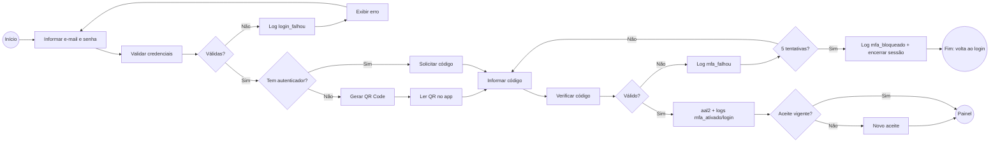
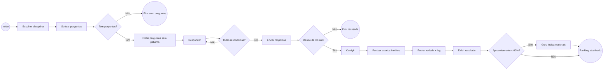

# BPMN — roteiro para redesenhar (Bizagi, draw.io ou bpmn.io)

O BPMN é desenhado numa ferramenta própria, então aqui fica **a lista exata de elementos
e ligações** que cada figura precisa ter. Os blocos em Mermaid servem só como rascunho
visual da ordem; a figura final deve usar a notação BPMN (eventos em círculo, tarefas em
retângulo arredondado, gateways em losango).

Regras de notação apontadas pelo orientador (valem para as duas figuras):
- **Fluxo de sequência é sempre linha contínua**, inclusive as saídas "Não" dos gateways.
  Linha tracejada em BPMN é só **fluxo de mensagem** (entre raias de participantes diferentes)
  ou **associação** (ligar anotação/artefato).
- **Sem cruzamentos ambíguos:** cada saída de tarefa sai por um lado diferente; se duas
  linhas precisam se cruzar, use um ponto de ligação ou reposicione a tarefa.
- Nada de "\n" aparecendo no texto; conferir a acentuação de todos os rótulos.
- Nenhum elemento "previsto": tudo o que está nas duas figuras está implementado.

---

## Figura 4 — Login com verificação em duas etapas (corrigida)

**Raias:** Usuário · Sistema (front-end) · Supabase (Auth + Banco)

| # | Elemento | Tipo | Raia | Sai para |
|---|---|---|---|---|
| 1 | Acessar a tela de login | Evento de início | Usuário | 2 |
| 2 | Informar e-mail e senha | Tarefa | Usuário | 3 |
| 3 | Validar credenciais | Tarefa | Supabase | G1 |
| G1 | Credenciais válidas? | Gateway exclusivo | Sistema | Não → 4 · Sim → G2 |
| 4 | Registrar log "login_falhou" (só se o e-mail tem conta; máx. 20 a cada 10 min) | Tarefa | Supabase | 5 |
| 5 | Exibir "E-mail ou senha inválidos" | Tarefa | Sistema | volta para 2 |
| G2 | Usuário já tem autenticador cadastrado? | Gateway exclusivo | Sistema | Não → 6 · Sim → 8 |
| 6 | Gerar QR Code (descarta cadastros não confirmados) | Tarefa | Supabase | 7 |
| 7 | Ler o QR Code no aplicativo autenticador | Tarefa | Usuário | 9 |
| 8 | Solicitar código de 6 dígitos | Tarefa | Sistema | 9 |
| 9 | Informar código | Tarefa | Usuário | 10 |
| 10 | Verificar código (challenge + verify) | Tarefa | Supabase | G3 |
| G3 | Código válido? | Gateway exclusivo | Sistema | Não → 11 · Sim → 14 |
| 11 | Registrar log "mfa_falhou" | Tarefa | Supabase | G4 |
| G4 | Chegou a 5 tentativas erradas? | Gateway exclusivo | Sistema | Não → 9 · Sim → 12 |
| 12 | Registrar log "mfa_bloqueado" e encerrar a sessão | Tarefa | Supabase | 13 |
| 13 | Voltar ao login com aviso | Evento de fim (erro/exceção) | Sistema | — |
| 14 | Elevar sessão a aal2 e registrar "mfa_ativado" (1º acesso) e "login" | Tarefa | Supabase | G5 |
| G5 | Aceite da versão vigente do Termo/Política registrado? | Gateway exclusivo | Sistema | Não → 15 · Sim → 16 |
| 15 | Exibir novo aceite (aceitar ou excluir a conta) | Tarefa | Usuário | 16 |
| 16 | Acessar o Painel | Evento de fim | Sistema | — |

**Para não cruzar linhas (pedido do orientador):** a saída do 6 ("Gerar QR Code") desce
para o 7 na raia do Usuário; a saída do 8 ("Solicitar código") vai pela direita direto
para o 9. As duas chegam ao 9 por lados diferentes (uma por cima, outra pela esquerda).

**Exceção de limite de tentativas:** G4 + tarefa 12 + evento de fim 13. Se preferir a
notação de exceção, use um **evento intermediário de erro** na borda da tarefa 10
("5 códigos inválidos") ligado à tarefa 12.

**Texto abaixo da figura (substitui "Nenhuma dessas etapas de MFA está implementada"):**

> A Figura 4 representa o fluxo de autenticação implementado. Após a validação de e-mail
> e senha pelo Supabase Auth, o sistema verifica se o usuário já possui um aplicativo
> autenticador cadastrado: no primeiro acesso é exibido o QR Code; nos seguintes, apenas
> o código de 6 dígitos é solicitado. Cada código inválido é registrado no log de
> auditoria e, após cinco tentativas erradas, a sessão é encerrada e o usuário precisa
> informar a senha novamente. Somente com o código válido a sessão é elevada ao nível
> aal2, exigido pelas políticas de segurança do banco de dados, e o sistema confere se o
> usuário aceitou a versão vigente do Termo de Aceite e da Política de Privacidade antes
> de liberar o Painel.

---

## Figura nova — Processo central: Quiz → Pontuação → Ranking → Guru

Pedido do orientador: "Quando o módulo avançar, criar um BPMN do processo central". O
módulo está implementado, então esta figura entra agora (sugestão: Figura 5, na seção 3.3).

**Raias:** Aluno · Sistema (front-end) · Banco de dados (funções do Supabase)

| # | Elemento | Tipo | Raia | Sai para |
|---|---|---|---|---|
| 1 | Abrir a tela Quiz | Evento de início | Aluno | 2 |
| 2 | Escolher a disciplina | Tarefa | Aluno | 3 |
| 3 | Sortear até 10 perguntas com gabarito (iniciar_quiz) e descartar rodada aberta anterior | Tarefa | Banco | G1 |
| G1 | A disciplina tem perguntas prontas? | Gateway exclusivo | Banco | Não → 4 · Sim → 5 |
| 4 | Informar "disciplina sem perguntas" | Evento de fim | Sistema | — |
| 5 | Exibir perguntas (sem o gabarito) | Tarefa | Sistema | 6 |
| 6 | Responder as perguntas | Tarefa | Aluno | G2 |
| G2 | Todas respondidas? | Gateway exclusivo | Sistema | Não → 6 (aviso "falta responder N") · Sim → 7 |
| 7 | Enviar respostas (finalizar_quiz) | Tarefa | Sistema | G3 |
| G3 | Rodada dentro de 30 minutos e ainda aberta? | Gateway exclusivo | Banco | Não → 8 · Sim → 9 |
| 8 | Recusar e pedir novo quiz | Evento de fim (erro) | Banco | — |
| 9 | Corrigir comparando com o gabarito | Tarefa | Banco | 10 |
| 10 | Pontuar acertos inéditos (Fácil 10, Médio 20, Difícil 30) | Tarefa | Banco | 11 |
| 11 | Fechar a rodada e registrar log "quiz_finalizado" | Tarefa | Banco | 12 |
| 12 | Exibir resultado (acertos, pontos, resposta correta) | Tarefa | Sistema | G4 |
| G4 | Aproveitamento da rodada abaixo de 60%? | Gateway exclusivo | Sistema | Sim → 13 · Não → 14 |
| 13 | Guru: indicar materiais da disciplina | Tarefa | Sistema | 14 |
| 14 | Ranking atualizado (soma dos pontos) | Evento de fim | Banco | — |

Anotação (associação, linha pontilhada) ligada à tarefa 13: *"No Painel, o Guru também
considera o histórico: aproveitamento < 60% com pelo menos 5 respostas na disciplina."*

