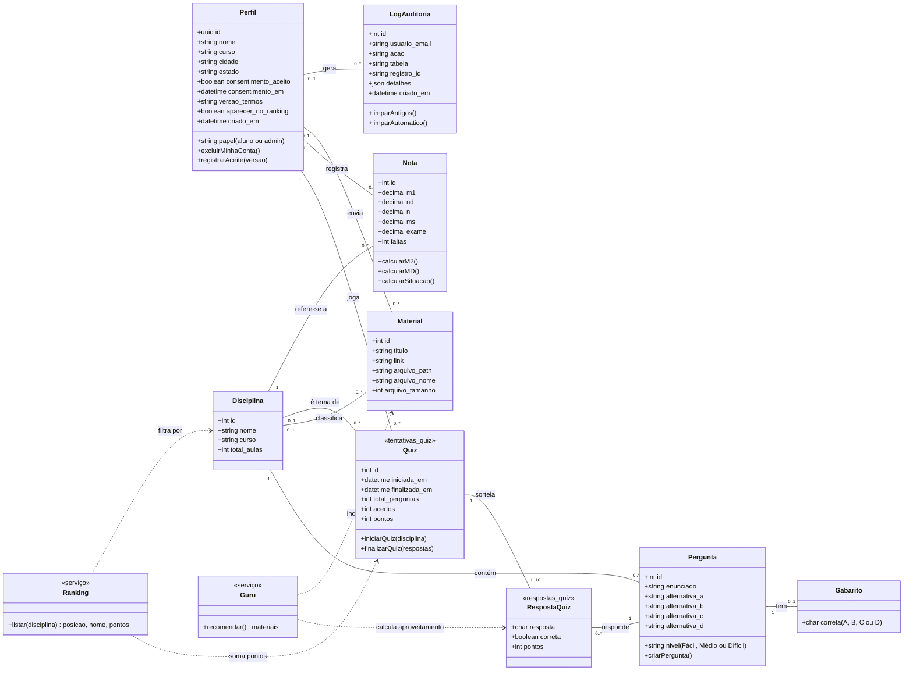

# Diagrama de Classes (Figura 2) — versão da entrega 09/11

Este diagrama é **igual ao banco de dados** depois das atualizações 00 a 12. Cada classe
é uma tabela (ou função) que existe de verdade, então ele pode substituir a Figura 2.

**Como exportar em alta resolução (pedido do orientador, item 4):**
1. Abra https://mermaid.live
2. Cole o bloco de código abaixo (só o que está entre as linhas com três crases).
3. Menu **Actions → PNG** com escala 3x ou 4x (ou **SVG**, que nunca perde qualidade).
4. Os nomes das classes estão sem acento porque o Mermaid não aceita acento em
   identificadores. Os rótulos das associações e os textos estão acentuados.

> **Na figura da monografia (ferramenta de UML, ex.: Astah/draw.io)**, desenhe
> Quiz `0..*` —— `1..10` Pergunta e ligue RespostaQuiz a essa linha com uma linha
> tracejada (classe de associação). O Mermaid não tem esse símbolo, por isso aqui
> aparece como duas associações, que significam a mesma coisa.

## O que mudou em relação à Figura 2 entregue (item 4 do feedback)

| Pedido do orientador | Como ficou |
|---|---|
| `Pergunta.disciplina` era texto, sem FK | Agora é `perguntas.disciplina_id` com chave estrangeira para `disciplinas` (atualização 11). A associação Disciplina–Pergunta existe no banco. |
| Associações "cadastra (admin)" não existem | **Removidas.** Nenhuma tabela guarda quem cadastrou disciplina/pergunta. A única autoria guardada é a do material (`enviado_por`), por isso ficou "Perfil envia Material". Quem cadastrou disciplinas e perguntas fica registrado no **log de auditoria**, não numa coluna. |
| Pergunta precisa de alternativas e gabarito | 4 alternativas na própria pergunta; o gabarito fica na classe **Gabarito** (tabela separada, só admin lê — atende também o "aluno não pode ler o gabarito"). |
| Guru deve se relacionar com Material | `Guru ..> Material : indica` |
| Material precisa de tag ou disciplina | `materiais.disciplina_id` (opcional) — `Disciplina classifica Material`. |
| Quiz–Pergunta é muitos-para-muitos | Quiz `0..*` — `1..10` Pergunta, com a classe de associação **RespostaQuiz** (resposta dada, se acertou, pontos). |
| Quiz e Ranking devem se associar a Disciplina | `Disciplina é tema de Quiz` e `Ranking filtra por Disciplina`. |
| Resultado e Diagnostico não existem como classes | **Removidas.** O resultado é a própria linha de Quiz (acertos, pontos) + RespostaQuiz; o "diagnóstico" é o cálculo do Guru. |
| Marcar classes novas como «Projetada» | Todas as classes acima **estão implementadas**, então nenhuma leva «Projetada». Ranking e Guru levam «serviço» porque são funções do banco (`ranking()` e `recomendacoes_guru()`), não tabelas. |
| Corrigir o "\n" e a acentuação | Neste diagrama não há "\n"; os rótulos estão acentuados. |

## Correspondência classe → banco

| Classe | Tabela / função | Script |
|---|---|---|
| Perfil | `perfis` (+ `auth.users` do Supabase) | setup, 3, 4, 11 |
| Disciplina | `disciplinas` | 00, 12 |
| Pergunta | `perguntas` | 00, 11 |
| Gabarito | `gabaritos` | 11 |
| Material | `materiais` | 00, 2, 4, 11 |
| Quiz | `tentativas_quiz` | 11 |
| RespostaQuiz | `respostas_quiz` | 11 |
| Nota | `notas` | 12 |
| LogAuditoria | `logs_auditoria` | setup, 4, 6, 10 |
| Ranking | função `ranking()` | 11 |
| Guru | funções `meu_desempenho()` e `recomendacoes_guru()` | 11 |
